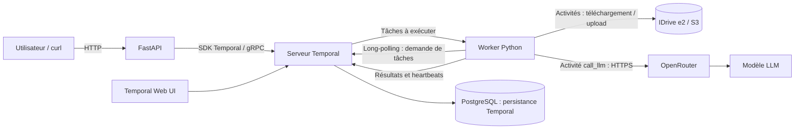
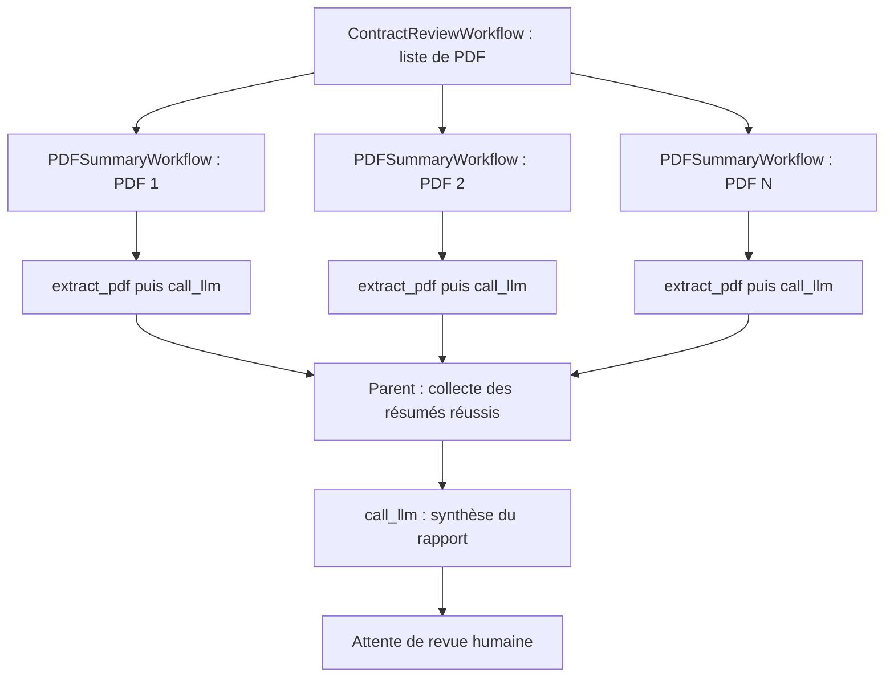
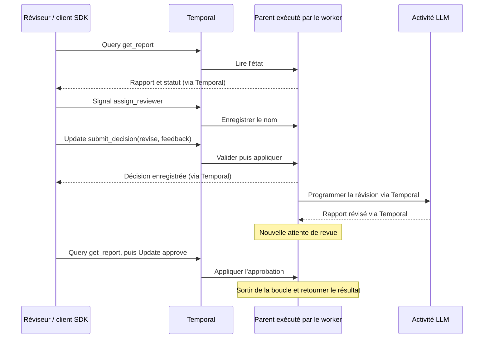
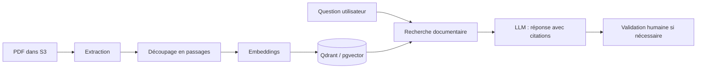

# Notes techniques — comprendre et développer le projet avec Temporal

Cette fiche explique les concepts, bibliothèques et mots-clés utilisés dans le projet. Les exemples de code sont des extraits pédagogiques : ils montrent une responsabilité précise et ne constituent pas chacun un programme complet.

Pour installer et lancer les composants, consulter [GUIDE_COMMANDES.md](GUIDE_COMMANDES.md). Pour comprendre le code, commencer par les sections ci-dessous.

## Sommaire

1. [Les trois applications](#1-les-trois-applications)
2. [Architecture et circulation des tâches](#2-architecture-et-circulation-des-tâches)
3. [Bibliothèques et imports](#3-bibliothèques-et-imports)
4. [Données et dataclasses](#4-données-et-dataclasses)
5. [Activités](#5-activités)
6. [Workflows](#6-workflows)
7. [Retries, timeouts et heartbeats](#7-retries-timeouts-et-heartbeats)
8. [Parent et enfants : revue de contrats](#8-parent-et-enfants--revue-de-contrats)
9. [Queries, Signals, Updates et validation humaine](#9-queries-signals-updates-et-validation-humaine)
10. [Worker, client et FastAPI](#10-worker-client-et-fastapi)
11. [Configuration et exploitation](#11-configuration-et-exploitation)
12. [Points à améliorer et extensions IA](#12-points-à-améliorer-et-extensions-ia)
13. [Mémo des décorateurs et mots-clés](#13-mémo-des-décorateurs-et-mots-clés)

## 1. Les trois applications

| Dossier | Objectif | Coordination |
|---|---|---|
| `apps/pdf-extraction-01-plain` | Télécharger un PDF depuis S3, extraire du Markdown, uploader le résultat | Script Python séquentiel |
| `apps/pdf-extraction-02-temporal` | Réaliser les mêmes étapes avec récupération après incident | `PDFPipelineWorkflow` et trois activités |
| `apps/ai-contract-review` | Résumer plusieurs contrats, synthétiser les risques, attendre une décision humaine | Parent `ContractReviewWorkflow`, enfants `PDFSummaryWorkflow` et activités |
| `apps/client-app` | Exposer des opérations REST pour démarrer et consulter les workflows | FastAPI utilisant le client Temporal |

Temporal conserve l'historique d'exécution et coordonne les tâches. Le code métier continue à s'exécuter dans nos workers Python.

## 2. Architecture et circulation des tâches



| Composant | Responsabilité |
|---|---|
| Frontend Service | Point d'entrée des demandes SDK et CLI ; différent de la Web UI |
| History Service | État des exécutions, événements et timers durables |
| Matching Service | Associer les tâches disponibles aux workers qui les demandent |
| Task Queue | Nom logique qui route les tâches vers les workers inscrits |
| Worker applicatif | Exécuter nos workflows et activités |
| Workers internes du serveur | Effectuer les tâches système de Temporal, distinctes de nos workers Python |
| Namespace | Espace logique qui regroupe des workflows ; ici généralement `default` |
| PostgreSQL | Persister les données du serveur Temporal |
| Web UI | Inspecter les exécutions, événements, erreurs et retries |

**Long-polling** : le worker demande du travail au serveur et attend une réponse. Le serveur ne lance pas directement un script sur notre ordinateur. Le client et le worker doivent utiliser le bon namespace et la bonne task queue.

**Durable execution et replay** : après un redémarrage, le worker peut reconstruire l'état du workflow à partir des événements enregistrés. Une activité dont le résultat est enregistré n'est pas appelée de nouveau simplement parce que le workflow est rejoué. Une activité dont le résultat n'a pas été enregistré peut être réexécutée.

**Idempotence** : une opération répétée doit produire un effet métier acceptable, par exemple un upsert avec un identifiant stable. Temporal ne garantit pas qu'un effet externe ne se produira qu'une seule fois.

## 3. Bibliothèques et imports

| Import / bibliothèque | Utilisation dans le projet |
|---|---|
| `temporalio.workflow` | Définir les workflows, programmer activités/enfants, attendre des événements |
| `temporalio.activity` | Définir les activités, journaliser et envoyer des heartbeats |
| `temporalio.client.Client` | Se connecter au serveur et démarrer/interagir avec une exécution |
| `temporalio.worker.Worker` | Enregistrer nos implémentations et traiter les tâches |
| `temporalio.common.RetryPolicy` | Configurer les retries d'une activité |
| `temporalio.workflow.ParentClosePolicy` | Définir le devenir des enfants lorsque le parent ferme |
| `temporalio.exceptions.ApplicationError` | Signaler une erreur métier au runtime Temporal |
| `dataclasses.dataclass` | Décrire les entrées et sorties sous forme de classes de données |
| `datetime.timedelta` | Exprimer des durées : secondes, minutes, jours |
| `asyncio` | Exécuter des coroutines et coordonner les enfants avec `gather` |
| `boto3` | Client S3 : télécharger et uploader des objets |
| `fitz` / `pymupdf` | PyMuPDF : ouvrir et inspecter les PDF, notamment le nombre de pages |
| `pymupdf4llm` | Convertir des pages PDF en Markdown |
| `dotenv.load_dotenv` | Charger la configuration depuis `.env` |
| `os.environ` | Lire les variables d'environnement |
| `pathlib.Path` | Construire et manipuler les chemins locaux |
| `openai.OpenAI` | Client compatible OpenAI utilisé ici pour appeler OpenRouter |
| `json` | Sérialiser ou désérialiser du JSON valide |
| `json_repair` | Tenter de réparer et parser une réponse JSON du modèle |
| FastAPI / Pydantic | Exposer les routes HTTP et définir/valider les requêtes API |
| Uvicorn | Lancer le serveur qui exécute l'application FastAPI |

Dans les workflows, le projet utilise :

```python
from temporalio import workflow
from temporalio.common import RetryPolicy

with workflow.unsafe.imports_passed_through():
    from activities import call_llm, CallLLMInput
```

`imports_passed_through()` permet de réutiliser les modules importés plutôt que de les réimporter dans le sandbox du workflow. Il faut l'utiliser pour des modules adaptés à cette réutilisation. Cela ne rend pas leurs opérations réseau ou disque autorisées dans le workflow. Ici, le workflow programme `call_llm` comme activité ; il ne l'appelle pas directement pour effectuer la requête HTTP.

## 4. Données et dataclasses

### `@dataclass` : structurer les entrées et sorties

Ce décorateur vient de Python, pas de Temporal. Il génère notamment un constructeur `__init__`, une représentation lisible et une comparaison basée sur les champs.

```python
from dataclasses import dataclass

@dataclass
class ContractReviewInput:
    s3_paths: list
    max_revisions: int = 2

params = ContractReviewInput(
    s3_paths=["s3://temporal-dev/files/Receipt-2520-5655.pdf"],
    max_revisions=2,
)
```

`params.s3_paths` contient les documents à traiter. Les annotations facilitent la lecture et la conversion des données, mais une dataclass ne valide pas automatiquement les types à l'exécution. Pour une interface HTTP, Pydantic apporte une validation dédiée.

### `@dataclass(frozen=True)` : empêcher la réaffectation des champs

Dans `child_workflow.py` :

```python
@dataclass(frozen=True)
class PDFSummaryOutput:
    s3_path: str
    summary: str
    key_risks: str
```

Après création, on ne peut pas réaffecter normalement `output.summary`. Ce n'est pas une immutabilité profonde des éventuels objets contenus dans les champs.

**Payload** : données transmises à une activité, un workflow ou un handler. Le SDK sait convertir des structures prises en charge, dont les dataclasses. Pour de grands documents, privilégier des références S3 plutôt que du texte volumineux dans l'historique.

## 5. Activités

### `@activity.defn` : déclarer une unité de travail

Une activité réalise une opération concrète : appel réseau, extraction PDF, téléchargement ou appel LLM.

```python
from temporalio import activity

@activity.defn
async def call_llm(params: CallLLMInput) -> CallLLMOutput:
    # Le corps de cette activité appelle OpenRouter.
    ...
```

Le décorateur rend la fonction enregistrable comme activité. Pour l'exécuter avec Temporal, il faut aussi l'enregistrer dans le worker.

### `workflow.execute_activity()` : programmer une activité

```python
llm_result = await workflow.execute_activity(
    call_llm,
    CallLLMInput(prompt=llm_prompt),
    start_to_close_timeout=timedelta(minutes=3),
    heartbeat_timeout=timedelta(seconds=180),
    retry_policy=DEFAULT_RETRY_POLICY,
)
```

Le workflow demande au serveur de programmer l'activité. Un worker exécute celle-ci ; le résultat revient au workflow et est enregistré dans l'historique.

**Ne pas remplacer cette instruction par `await call_llm(...)` dans le workflow** : ce serait un appel direct à la fonction, sans la programmation d'une activité Temporal.

### `async def` et `await`

`async def` définit une coroutine. `await` permet d'attendre son résultat sans bloquer le thread comme une attente synchrone classique. Cependant, un appel synchrone bloquant à l'intérieur d'une coroutine bloque toujours l'event loop.

Dans le code actuel, des activités `async` utilisent boto3, PyMuPDF et le client OpenAI synchrones. Pour mieux gérer la concurrence, utiliser des clients réellement asynchrones ou des activités synchrones avec un `activity_executor`, par exemple un `ThreadPoolExecutor`. Le nombre de threads doit être coordonné avec la capacité des workers et les quotas du fournisseur.

## 6. Workflows

### `@workflow.defn` : déclarer la classe du workflow

```python
@workflow.defn
class ContractReviewWorkflow:
    ...
```

La classe représente la logique de coordination et son état. Elle doit être enregistrée dans le worker. Un workflow n'est ni un serveur ni un processus système dédié.

### `@workflow.run` : définir le point d'entrée

```python
# Coordonne les quatre étapes principales de la revue de contrats.
@workflow.run
async def run(self, params: ContractReviewInput) -> ContractReviewOutput:
    await self._process_pdfs(params.s3_paths)
    await self._synthesize_report()
    await self._review_report(params.max_revisions)
    return self._build_output()
```

Le SDK appelle cette méthode lorsque l'exécution démarre. Une classe workflow possède un point d'entrée `run` décoré. Les autres méthodes privées peuvent être de simples helpers Python.

| Méthode du parent refactorisé | Rôle |
|---|---|
| `_process_pdfs` | Démarrer les enfants et collecter les résumés réussis |
| `_synthesize_report` | Préparer le prompt du rapport global |
| `_generate_report` | Programmer l'activité LLM puis parser le JSON |
| `_review_report` | Coordonner les cycles de revue humaine |
| `_wait_for_review_decision` | Attendre la décision avec un timeout durable |
| `_revise_report` | Préparer et générer un rapport révisé |
| `_build_output` | Construire le résultat final |

Ces helpers ne sont pas de nouvelles activités ou de nouveaux workflows. Ils organisent le code dans la même exécution parent. Les opérations externes restent dans les activités.

### Déterminisme

Au replay, la logique du workflow doit rester compatible avec les commandes enregistrées. Mettre les appels LLM, réseau et disque dans des activités. Utiliser les APIs de workflow pour les timers et les opérations sensibles au replay, par exemple `workflow.sleep()` plutôt que `time.sleep()`.

Modifier un workflow qui possède déjà des exécutions en cours demande de vérifier la compatibilité avec leurs historiques. Une simple factorisation qui conserve les mêmes commandes n'a pas le même impact qu'un changement de leur ordre. Les tests de replay servent à vérifier cette compatibilité.

## 7. Retries, timeouts et heartbeats

### RetryPolicy

Dans la revue de contrats :

```python
DEFAULT_RETRY_POLICY = RetryPolicy(
    initial_interval=timedelta(seconds=3),
    backoff_coefficient=2.0,
    maximum_interval=timedelta(seconds=60),
    maximum_attempts=4,
)
```

| Paramètre | Signification |
|---|---|
| `initial_interval` | Première attente avant une nouvelle tentative |
| `backoff_coefficient` | Facteur de croissance des attentes |
| `maximum_interval` | Plafond du délai entre deux tentatives |
| `maximum_attempts` | Nombre total de tentatives, première comprise |

Ici : une première tentative, puis jusqu'à trois retries après des délais de 3, 6 et 12 secondes. Le plafond de 60 secondes intervient si le budget de tentatives est augmenté. Ce sont les retries des activités ; ils ne configurent pas automatiquement un retry global des workflows enfants.

Une erreur permanente peut être déclarée non réessayable :

```python
from temporalio.exceptions import ApplicationError

raise ApplicationError(
    "Document non pris en charge",
    type="InvalidDocument",
    non_retryable=True,
)
```

Cet extrait montre une possibilité du SDK, pas une validation déjà implémentée partout dans le projet. Coordonner les retries Temporal avec ceux de boto3 ou du client LLM pour éviter des tentatives et coûts excessifs.

### Timeouts

| Option | Temps limité | Usage actuel |
|---|---|---|
| `start_to_close_timeout` | Durée d'une tentative d'activité | Oui |
| `schedule_to_close_timeout` | Durée totale incluant attente et retries | Extension possible |
| `schedule_to_start_timeout` | Attente avant prise en charge par un worker | Extension possible |
| `heartbeat_timeout` | Durée maximale sans heartbeat reçu | Oui, revue de contrats |

Valeurs actuelles :

| Activité | Timeout par tentative | Heartbeat timeout |
|---|---|---|
| PDF simple : download | 3 minutes | Non configuré |
| PDF simple : extract | 10 minutes | Non configuré |
| PDF simple : upload | 3 minutes | Non configuré |
| Enfant contrat : extract_pdf | 20 minutes | 30 secondes |
| Enfant contrat : call_llm | 5 minutes | 180 secondes |
| Parent : synthèse ou révision LLM | 3 minutes | 180 secondes |

### `activity.heartbeat()` : signaler la progression

Extrait de l'extraction des contrats :

```python
activity.heartbeat({
    "stage": "extracting",
    "s3_path": params.s3_path,
    "pages_done": end_page,
    "total_pages": total_pages,
    "progress_pct": round(end_page / total_pages * 100),
})
```

Le heartbeat indique que l'activité progresse. Son absence peut provoquer un timeout et un retry éligible. Le SDK peut limiter la fréquence de transmission effective des heartbeats.

Les détails du dernier heartbeat reçu peuvent être consultés à la tentative suivante avec `activity.info().heartbeat_details`. Mais reprendre réellement au bon endroit nécessite un checkpoint durable et une logique de restauration. Le projet rapporte des lots de pages ; il ne reprend pas encore automatiquement à partir du dernier lot.

L'activité LLM envoie actuellement un heartbeat avant son appel réseau, sans boucle périodique pendant l'appel. Un appel bloquant long ou une page très lente peut donc dépasser le délai autorisé. Les heartbeats facilitent aussi la transmission de l'annulation aux activités ; le nettoyage des ressources reste à implémenter.

## 8. Parent et enfants : revue de contrats



### `workflow.start_child_workflow()` et `asyncio.gather()`

```python
handles = await asyncio.gather(
    *[
        workflow.start_child_workflow(
            PDFSummaryWorkflow.run,
            PDFSummaryInput(s3_path=current_s3_path),
            id=f"{workflow_id}-pdf-{idx + 1}",
            task_queue=workflow_task_queue,
            parent_close_policy=ParentClosePolicy.ABANDON,
        )
        for idx, current_s3_path in enumerate(s3_paths)
    ]
)

raw_results = await asyncio.gather(
    *handles,
    return_exceptions=True,
)
```

- **Fan-out** : démarrer un enfant pour chaque document.
- **Handle** : référence permettant d'attendre ou d'interagir avec une exécution.
- **Fan-in** : rassembler les résultats avant la synthèse.
- `*` : déplier une liste en arguments pour `gather`.
- Le premier `gather` attend le démarrage des enfants ; le second attend leurs résultats.
- `return_exceptions=True` permet de traiter les erreurs individuelles comme des résultats à inspecter.
- Chaque enfant possède son identifiant et son historique ; la communication avec le parent passe par Temporal.

Un enfant extrait son PDF et appelle le modèle avec les **5 000 premiers caractères** du Markdown. Il retourne `s3_path`, `summary` et `key_risks`. Le parent accepte les enfants réussis, journalise les échecs, et échoue si aucun document n'a réussi.

### `ParentClosePolicy`

| Valeur | Lorsque le parent ferme |
|---|---|
| `TERMINATE` | Terminer les enfants concernés |
| `REQUEST_CANCEL` | Demander leur annulation |
| `ABANDON` | Les laisser continuer ; choix actuel du projet |

Un redémarrage du worker n'est pas une fermeture du parent. La task queue commune ne garantit pas que tous les enfants tourneront sur la même machine. Le parallèle effectif dépend des capacités des workers et des limites des fournisseurs.

**Workflow enfant ≠ sous-agent automatique.** Ici les étapes sont prédéfinies. Un enfant pourrait héberger un sous-agent si un modèle décide des actions et outils à utiliser ; Temporal en gérerait alors le cycle de vie durable.

## 9. Queries, Signals, Updates et validation humaine

| Interface | Lire / modifier l'état | Retour au client | Exemple |
|---|---|---|---|
| Query | Lire, sans mutation | Résultat de lecture | Consulter le rapport |
| Signal | Modifier via un message asynchrone | Pas de résultat du handler | Affecter un réviseur |
| Update | Modifier via un handler validable | Résultat ou erreur du handler | Demander une révision |

### `@workflow.query` : lire l'état

Exemple réel du parent :

```python
@workflow.query
def get_report(self) -> dict:
    return {
        "status": self._status,
        "report": self._report,
        "approved_by": self._approved_by,
        "sources": [s["s3_path"] for s in self._summaries],
    }
```

Une Query ne modifie pas l'état et n'est pas un événement durable de mutation. Il faut un worker capable de servir cette lecture. Pour le statut d'exécution global, le client peut aussi utiliser `handle.describe()` ; ce n'est pas la même chose que notre Query métier `get_status`.

### `@workflow.signal` : envoyer un message

```python
@workflow.signal
async def assign_reviewer(self, name: str) -> None:
    self._approved_by = name
```

Le serveur enregistre le Signal pour l'exécution. Le retour du client ne signifie pas que le handler a fini de l'appliquer. Ici, le nom est enregistré dans `_approved_by` dès l'affectation : il ne prouve pas une approbation ni une identité authentifiée.

### `@workflow.update` : modifier l'état avec un résultat

```python
@workflow.update
async def submit_decision(self, decision: str, feedback: str = "") -> str:
    self._review_decision = decision
    self._review_feedback = feedback
    return f"Decision '{decision}' recorded."
```

`execute_update` permet au client d'attendre le résultat du handler. L'accusé de réception de `submit_decision` signifie que la décision est enregistrée, pas que le rapport révisé est déjà prêt.

### `@submit_decision.validator` : valider avant la mutation

```python
@submit_decision.validator
def validate_decision(self, decision: str, feedback: str = "") -> None:
    if decision not in ("approve", "revise"):
        raise ValueError(f"Must be 'approve' or 'revise', got: '{decision}'")
    if decision == "revise" and not feedback.strip():
        raise ValueError("Feedback is required when requesting a revision.")
```

Le décorateur associe le validateur à l'Update `submit_decision`. La méthode reste synchrone et ne doit pas modifier l'état du workflow. Une décision invalide est rejetée avant le handler. Ce contrôle métier ne remplace pas l'authentification du réviseur.

### `workflow.wait_condition()` : attendre durablement

```python
await workflow.wait_condition(
    lambda: self._review_decision is not None,
    timeout=timedelta(days=3),
)
```

`lambda` définit une petite fonction qui teste l'état. L'Update change `_review_decision` ; lorsque la condition devient vraie, le workflow poursuit sa logique. Le timeout déclenche ici une `asyncio.TimeoutError`, interceptée par `_wait_for_review_decision`.



**Comportement actuel à connaître** : le parent passe à `completed` après approbation, mais aussi après timeout ou épuisement des cycles. `completed` ne veut donc pas dire « approuvé ». La boucle `range(max_revisions + 1)` peut produire une révision supplémentaire sans nouvelle revue finale. Les décisions devraient aussi être liées à une version de rapport et acceptées uniquement dans l'état approprié.

## 10. Worker, client et FastAPI

### Worker : enregistrer et exécuter

Extrait du worker de revue de contrats :

```python
client = await Client.connect(TEMPORAL_HOST, namespace=TEMPORAL_NAMESPACE)
worker = Worker(
    client,
    task_queue=TEMPORAL_TASK_QUEUE,
    workflows=[ContractReviewWorkflow, PDFSummaryWorkflow],
    activities=[extract_pdf, call_llm],
)
await worker.run()
```

Décorer une fonction ne lance pas le worker. `worker.run()` démarre la boucle de traitement. Le même worker sait ici traiter le parent, les enfants et les activités.

### Client : démarrer et interagir

| API du client / handle | Rôle |
|---|---|
| `Client.connect(...)` | Établir une connexion avec le serveur |
| `client.start_workflow(...)` | Démarrer et obtenir un handle sans attendre le résultat final |
| `client.execute_workflow(...)` | Démarrer et attendre le résultat final |
| `client.get_workflow_handle(id)` | Obtenir une référence à une exécution identifiée |
| `handle.result()` | Attendre le résultat d'une exécution |
| `handle.describe()` | Lire les informations d'exécution du serveur |
| `handle.query(...)` | Lire l'état métier exposé par une Query |
| `handle.signal(...)` | Envoyer un Signal |
| `handle.execute_update(...)` | Exécuter une Update et attendre son résultat |

```python
handle = client.get_workflow_handle(workflow_id)
report = await handle.query("get_report")
await handle.signal("assign_reviewer", "Reviewer A")
ack = await handle.execute_update(
    "submit_decision",
    args=["revise", "Clarifier les risques de résiliation."],
)
```

`workflow_id` identifie le processus métier ; `run_id` identifie une exécution particulière de ce workflow. Ne pas confondre l'identifiant avec le nom de classe ou la task queue.

### FastAPI, Uvicorn et curl

- `@app.get(...)` / `@app.post(...)` déclarent les routes HTTP de FastAPI : ce ne sont pas des décorateurs Temporal.
- `uvicorn main:app --reload --port 5000` lance l'API ; `--reload` sert au développement.
- `curl http://127.0.0.1:5000/health` vérifie la santé de l'API, pas nécessairement celle de tous ses services.
- Un POST de traitement demande à l'API de démarrer un workflow ; le worker effectue ensuite les activités.
- Sur le Mac utilisé pour ce projet, `127.0.0.1:5000` évite le conflit rencontré avec `localhost:5000`. `localhost` peut se résoudre en IPv4 ou IPv6 ; `127.0.0.1` cible explicitement le loopback IPv4.

Les handlers REST de revue de contrats sont actuellement commentés dans `main.py`. Leur présence dans un exemple curl ne suffit pas à les rendre disponibles.

## 11. Configuration et exploitation

| Configuration | Rôle |
|---|---|
| `.env.example` | Modèle de configuration sans secrets réels |
| `.env` | Configuration locale chargée par l'application ; ne pas versionner les secrets |
| `AWS_ACCESS_KEY_ID` / `AWS_SECRET_ACCESS_KEY` | Identifiants du stockage S3 compatible |
| `AWS_REGION` / `AWS_S3_ENDPOINT_URL` | Région et endpoint IDrive e2 |
| `S3_BUCKET` | Nom du bucket ; le chemin S3 doit rester cohérent |
| `TEMP_DIR` | Répertoire local temporaire accessible au worker |
| `TEMPORAL_HOST` | Adresse du serveur, souvent `localhost:7233` en local |
| `TEMPORAL_NAMESPACE` | Namespace cible |
| `TEMPORAL_TASK_QUEUE` | Queue que le worker écoute |
| `OPENROUTER_API_KEY` / `OPENROUTER_MODEL` | Clé et modèle utilisés pour la revue de contrats |

Le client OpenAI appelle ici `https://openrouter.ai/api/v1`. Un abonnement ChatGPT et des crédits API sont des produits distincts ; la configuration de cette application utilise la clé OpenRouter.

Docker Compose démarre les services Temporal et PostgreSQL. La Web UI est généralement accessible sur `http://localhost:8080`. Temporal CLI permet de vérifier le cluster, démarrer des workflows et les inspecter. Exemple :

```bash
temporal operator cluster health --address localhost:7233
```

Conda crée l'environnement Python `temporaldev`; pip installe les dépendances de chaque application. Sous Linux, systemd peut superviser le worker. Sur macOS, utiliser un terminal pour le développement ou un service launchd adapté : copier un fichier `.service` Linux dans un dossier macOS ne le convertit pas.

La supervision redémarre un processus ; Temporal conserve le cycle de vie métier. Les deux responsabilités sont complémentaires.

## 12. Points à améliorer et extensions IA

### Limites concrètes du code actuel

- Le pipeline PDF à trois activités transmet un chemin local entre download et extract : un autre worker peut ne pas avoir le fichier.
- La revue de contrats combine téléchargement et extraction dans une activité, mais utilise le nom du fichier comme chemin temporaire : des exécutions concurrentes peuvent entrer en conflit. Prévoir des chemins uniques et un nettoyage garanti.
- Les appels synchrones dans des activités `async` limitent la concurrence et peuvent retarder les heartbeats.
- Le résumé utilise les 5 000 premiers caractères ; il ne garantit pas une analyse complète du contrat.
- `json_repair` aide à parser une réponse ; il ne valide pas le schéma ni la véracité des risques.
- Le rapport peut être une structure JSON alors que certaines annotations le décrivent comme `str` : les contrats de données doivent être harmonisés.
- Les échecs partiels et les états de revue doivent être visibles et validés selon les règles métier.
- La compatibilité des workflows existants nécessite des tests de replay ; les tests simulés de logique ne prouvent pas à eux seuls cette compatibilité.

### Évolution vers RAG et agents



Ce RAG est une extension proposée, pas une fonctionnalité déjà implémentée. Temporal peut coordonner l'ingestion, les reprises, les outils et les validations ; il ne remplace ni la base vectorielle ni la qualité de recherche.

Pour un agent, une activité LLM peut proposer une action ; le workflow valide cette action, appelle un outil autorisé et borne les étapes, le budget et les attentes humaines. Des enfants peuvent isoler des analyses spécialisées. Pour les historiques très longs, `Continue-As-New` permet de repartir sur un nouvel historique en transmettant l'état nécessaire ; cette API n'est pas encore utilisée ici.

## 13. Mémo des décorateurs et mots-clés

| Mot-clé | À retenir |
|---|---|
| `@dataclass` | Classe de données Python ; pas de validation automatique complète |
| `@dataclass(frozen=True)` | Empêcher la réaffectation normale des champs |
| `@activity.defn` | Déclarer une opération métier exécutée par un worker |
| `@workflow.defn` | Déclarer une classe de coordination Temporal |
| `@workflow.run` | Point d'entrée asynchrone du workflow |
| `@workflow.query` | Lire l'état sans le modifier |
| `@workflow.signal` | Recevoir un message asynchrone sans résultat de handler |
| `@workflow.update` | Modifier l'état et renvoyer un résultat au client |
| `@submit_decision.validator` | Vérifier les arguments avant l'Update sans muter l'état |
| `workflow.execute_activity` | Programmer une activité et attendre son résultat |
| `workflow.start_child_workflow` | Démarrer un enfant avec un historique distinct |
| `workflow.wait_condition` | Attendre une condition avec un timer durable éventuel |
| `workflow.info()` | Informations de l'exécution courante, dont ID et task queue |
| `activity.info()` | Informations de la tentative d'activité et détails de heartbeat |
| `activity.heartbeat()` | Signaler l'activité et la progression |
| `workflow.logger` / `activity.logger` | Journalisation dans le contexte Temporal |
| `RetryPolicy` | Délais et limites des retries |
| `ParentClosePolicy` | Comportement des enfants à la fermeture du parent |
| `asyncio.gather` | Coordonner plusieurs coroutines ou handles |
| `async def` / `await` | Définir une coroutine et attendre un résultat |
| `self._status` | État métier du parent ; `_` indique une convention interne Python |
| `Task Queue` / `Namespace` | Routage des tâches / regroupement logique |
| `Workflow ID` / `Run ID` | Identité du processus / identité d'une exécution |
| `Replay` / `Idempotence` | Reconstruire le workflow / supporter la répétition d'effets externes |

## Références

- [Documentation Temporal Python](https://docs.temporal.io/develop/python)
- [Référence du SDK Python](https://python.temporal.io/)
- [Exemples de serveur Temporal et Docker Compose](https://github.com/temporalio/samples-server)
- [Temporal CLI](https://docs.temporal.io/cli)
- [IDrive e2 — console des clés d'accès](https://console.idrivee2.com/access-key)
- [OpenRouter — documentation](https://openrouter.ai/docs/quickstart)
- [Dataclasses Python](https://docs.python.org/3/library/dataclasses.html)
