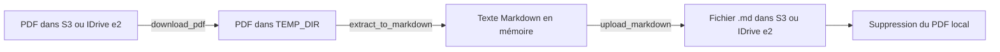

# Extraction PDF en Python — sans Temporal

Ce premier exemple transforme un PDF stocké dans S3 ou IDrive e2 en Markdown. Le script Python exécute toutes les étapes dans un seul processus, sans serveur Temporal, sans worker Temporal et sans API FastAPI.

Le dossier `../pdf-extraction-02-temporal` reprend ce traitement avec Temporal pour orchestrer les étapes et gérer les tentatives automatiques en cas d'échec.

## Préparation

Activez l'environnement Python et placez-vous dans ce dossier :

```bash
conda activate temporaldev
cd /Users/ET35771/Documents/AI/project/temporal-extraction-reviewer-agent/apps/pdf-extraction-01-plain
python -m pip install -r requirements.txt
```

Si vous n'avez pas encore de fichier `.env`, créez-le à partir du modèle :

```bash
cp .env.example .env
```

Ne recopiez pas le modèle sur un `.env` déjà configuré : cela remplacerait vos paramètres.

Renseignez votre `.env` avec les valeurs fournies par votre service S3 :

Pour IDrive e2, ouvrez la [console de gestion des clés d'accès](https://console.idrivee2.com/access-key) pour créer ou gérer vos clés S3. Depuis la console, vous pouvez aussi gérer vos buckets et importer le PDF à traiter.

```dotenv
AWS_ACCESS_KEY_ID=votre-access-key
AWS_SECRET_ACCESS_KEY=votre-secret-key
AWS_REGION=votre-region
AWS_S3_ENDPOINT_URL=https://votre-endpoint-s3
S3_BUCKET=temporal-dev
TEMP_DIR=/Users/ET35771/Documents/AI/project/temporal-extraction-reviewer-agent/apps/pdf-extraction-01-plain/tmp/pdf-pipeline
```

`.env.example` documente les paramètres attendus ; `.env` contient votre configuration réelle et vos clés privées. Ne publiez pas ces clés.

Le script charge `.env` avec `load_dotenv()`. Les variables déjà présentes dans l'environnement du terminal restent prioritaires. Le dossier `TEMP_DIR` est créé automatiquement au démarrage s'il n'existe pas. Si vous utilisez un autre emplacement pour le projet, adaptez son chemin absolu.

Dans le code actuel, le bucket utilisé pour lire et écrire vient du chemin `s3://...` passé au script. La variable `S3_BUCKET` est lue au démarrage, mais elle ne détermine pas le bucket du traitement.

## Lancer le traitement

Importez d'abord votre PDF dans le bucket, puis lancez :

```bash
python process_pdf.py s3://temporal-dev/files/Scikit-Learn_Cheat_Sheet.pdf
```

Le chemin contient le nom du bucket (`temporal-dev`) et la clé complète du fichier (`files/Scikit-Learn_Cheat_Sheet.pdf`). Le compte S3 doit avoir les droits de lecture du PDF et d'écriture du résultat.

## Déroulement du script



1. **Configuration** : le script charge les variables d'environnement et prépare le dossier temporaire.
2. **Téléchargement** : `download_pdf()` récupère le PDF depuis S3 et l'enregistre dans `TEMP_DIR`.
3. **Extraction** : `extract_to_markdown()` convertit le contenu du PDF avec `pymupdf4llm`. Le Markdown reste en mémoire ; cette étape ne crée pas de fichier `.md` local.
4. **Envoi** : `upload_markdown()` envoie le texte encodé en UTF-8 dans le même bucket. Pour l'exemple, la clé devient `files/Scikit-Learn_Cheat_Sheet.md`.
5. **Nettoyage** : après un envoi réussi, `process_pdf()` supprime le PDF temporaire et retourne le chemin S3 du Markdown.

Le terminal affiche les étapes du traitement, puis le chemin du résultat :

```text
Done! Markdown saved to: s3://temporal-dev/files/Scikit-Learn_Cheat_Sheet.md
```

## Rôle des fonctions

| Fonction | Rôle |
|---|---|
| `get_s3_client()` | Crée le client Boto3 avec les paramètres de connexion S3. |
| `parse_s3_path()` | Sépare le chemin S3 en bucket et clé du fichier. |
| `download_pdf()` | Télécharge le PDF et retourne son chemin local. |
| `extract_to_markdown()` | Lit le PDF local et retourne son contenu en Markdown. |
| `upload_markdown()` | Envoie le Markdown dans S3 et retourne son chemin S3. |
| `process_pdf()` | Exécute les trois étapes dans l'ordre, puis supprime le PDF local. |

## Bibliothèques utilisées

| Bibliothèque | Utilité |
|---|---|
| `boto3` | Téléchargement et envoi des fichiers avec l'API S3. |
| `pymupdf4llm` | Conversion du PDF en Markdown. |
| `python-dotenv` | Chargement de la configuration depuis `.env`. |
| `os` | Variables d'environnement, création du dossier et suppression du PDF. |
| `sys` | Lecture du chemin S3 fourni dans le terminal. |
| `logging` | Affichage des étapes et des messages de diagnostic. |
| `pathlib.Path` | Construction des chemins locaux et récupération du nom du fichier. |
| `tempfile` | Module de fichiers temporaires, importé mais non utilisé dans ce script. |

## Limites de cette version et passage à Temporal

Le traitement est séquentiel : une étape commence seulement lorsque la précédente a terminé. Le script n'implémente ni reprise durable ni politique de nouvelle tentative à l'échelle du traitement. Boto3 peut toutefois effectuer ses propres tentatives sur certaines requêtes réseau.

Si une erreur interrompt le script, il faut le relancer manuellement ; il reprend depuis le téléchargement. Le PDF local peut rester sur le disque, car sa suppression intervient uniquement après un envoi réussi. Des traitements simultanés de PDF portant le même nom peuvent utiliser le même fichier temporaire. Un résultat `.md` déjà présent à la même clé peut être remplacé par un nouvel envoi.

Dans `../pdf-extraction-02-temporal`, les trois étapes deviennent des **activités** pilotées par un **workflow**. Un worker Python les exécute et le serveur Temporal conserve l'historique de l'orchestration. Cette version ajoute des délais et des politiques de nouvelle tentative, ainsi qu'un suivi dans l'interface Temporal. Les fichiers locaux restent à gérer explicitement : Temporal ne les copie pas entre les workers.

Docker et le serveur Temporal ne sont pas nécessaires pour exécuter cet exemple `pdf-extraction-01-plain`.

## Une première brique pour un projet RAG et agentic AI

Ce travail prépare une étape essentielle d'un système d'IA documentaire : rendre le contenu de PDF disponibles dans un stockage S3 exploitable sous forme de texte structuré. Le pipeline relie le stockage des documents, leur extraction et la conservation du résultat en Markdown. La séparation en fonctions permet de réutiliser ces opérations dans des traitements plus larges.

La version actuelle réalise cette préparation documentaire. Elle ne contient pas encore de recherche vectorielle, de RAG ni d'agent autonome. Le Markdown produit constitue une entrée possible pour construire ces fonctionnalités.

### Évolution vers le RAG

Le RAG (Retrieval-Augmented Generation) consiste à rechercher des passages pertinents dans les documents avant de les fournir à un modèle de langage pour répondre à une question.

La chaîne d'ingestion pourrait évoluer ainsi :

```text
PDF dans IDrive e2
→ extraction en Markdown (ce premier exemple)
→ découpage en passages avec métadonnées de source et de page
→ création des embeddings, des représentations numériques des passages
→ indexation dans Qdrant ou PostgreSQL avec pgvector
```

À partir de cet index, une API pourrait rechercher les passages associés à une question, les transmettre au LLM et produire une réponse accompagnée de citations vérifiables. Il faudra conserver explicitement les références aux pages pendant l'extraction et le découpage ; le script actuel ne fournit pas de métadonnées de page séparées.

### Évolution vers les agents IA

Un agent IA pourrait utiliser la recherche documentaire comme un outil, puis choisir d'autres actions selon la demande : comparer plusieurs contrats, rechercher une clause, préparer un rapport ou demander une validation humaine. Un premier agent disposant de quelques outils peut suffire avant d'envisager plusieurs agents spécialisés.

Le dossier `../ai-contract-review` illustre déjà des appels LLM et une validation humaine autour de workflows parent et enfants. Cette orchestration fournit des mécanismes utiles pour un futur système d'agents ; elle ne constitue pas, à elle seule, une prise de décision autonome par un agent.

### Rôle de Temporal dans cette évolution

La version `../pdf-extraction-02-temporal` introduit une orchestration durable du pipeline. À plus grande échelle, Temporal peut suivre l'ingestion, l'indexation, les appels aux outils et les attentes de validation humaine, avec des délais et des politiques de nouvelle tentative adaptés.

Temporal coordonne l'exécution ; le moteur RAG assure la recherche documentaire et la logique de l'agent détermine les actions à effectuer. Les opérations externes restent dans les activités, tandis que le workflow organise leur enchaînement.

### Prochaines étapes proposées

1. Fiabiliser les fichiers temporaires, la validation des entrées et la gestion des erreurs.
2. Ajouter le découpage des documents, leurs métadonnées et une indexation vectorielle.
3. Construire une API de questions-réponses avec citations des sources.
4. Ajouter un agent capable de rechercher, comparer et produire des rapports.
5. Encadrer les accès aux documents et évaluer la qualité des réponses et des décisions.

Un premier objectif concret serait un assistant documentaire répondant aux questions sur les PDF avec des références vérifiables. Le travail réalisé ici constitue la première étape de cette progression, du script d'extraction à une application d'IA documentaire orchestrée avec Temporal.
